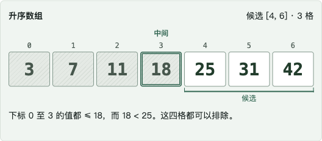
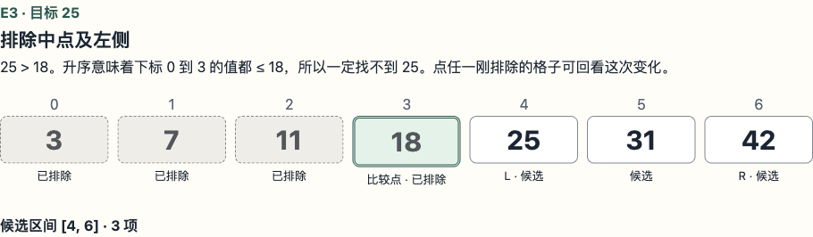
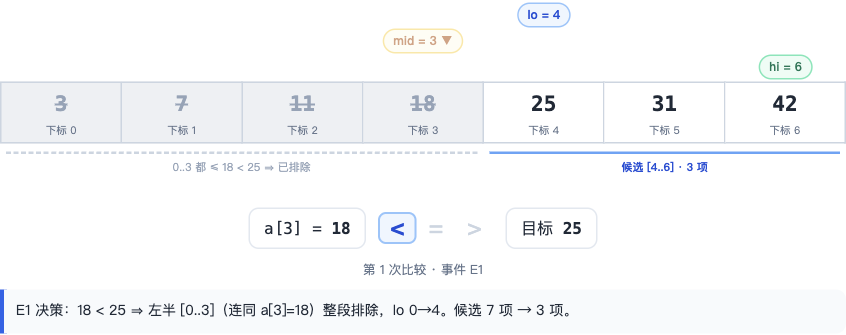

# 二分查找微课第二轮评审

## 根据学习者操作重新核验 Sol 原稿

原评审验证了“选区间、点 18、选理由”的预设路径，漏测了“只完成两组选项就提交”。在首题选择 C（保留 [4,6]）和 A（中点及其左侧都不大于 18），直接提交，页面仍停在 E2，“下一步”继续禁用。题干虽提到点选格子，画面已经标出了比较点，提交反馈又把漏点与依据错误合并处理。学生答对了两问，仍要自行发现第三项操作。**据此撤回把原稿作为六分钟独立自学首选的推荐。89 分仅保留为旧量表的历史记录。**

原量表的可视化五项记录的是状态正确、位置稳定、非颜色编码、可见变化和回查能力。原稿在四个格子下重复写“已排除”，要读上方段落才能知道四格为什么共享上界 18。视觉解释力不足，原表中的 20/20 不能解释成主图的教学质量满分。

下表中的 Sol 指模型原稿。另附[交互和主图修订版](Sol/修订版.html)，供复测 C＋A 直接提交及比较排除前后的区间。修订版由评审方修改，单独展示。

**本轮主例的可视化讲解，我选 GLM。Sol 的逐格回查可用，原稿首题的提交障碍影响独立练习。** 按首轮量表计算，两件成品的综合验收得分为 Sol 89、GLM 69。原量表里的“可视化制作”检查状态与数据是否一致、对象能否追溯等五项，对图能把因果关系讲得多清楚，区分度不足。[并排试做](对照.html) · [Sol 单独打开](Sol/index.html) · [GLM 单独打开](GLM/index.html)

## 同一步骤的视觉复评

三张图都取自浏览器中“找 25，第一次比较完，左侧四格刚刚被排除”的时刻。均为 1280 像素宽视口中的主图局部，首轮原型为双栏布局，后两张为单独打开的课程。事件编号随作者的分镜而异。

**首轮 Sol** 用斜纹划掉四格，绿色括线把余下的 25、31、42 连成一段。即使暂时盖住说明文字，也能从括线的起止位置读出保留的范围。

**本轮 Sol** 保留一行七格，改用虚线框和逐格文字标出“已排除”，在格子下写 L、R，另列候选区间。端点更明确，表示整段的括线却消失了。两轮的核心画面很接近。新增的逐格回看和判断错误理由，需要动手才体验得到；这两项解释了综合分的上升。

**本轮 GLM** 把三个问题放在一幅图里。抬头看旗标，能定位刚读过的下标 3 和新的左端 4；往下看，四个划掉的数共用一条“都 ≤ 18 < 25”的虚线，右边三个数共用一条候选实线；再下方直接呈现本次比较和“7 项 → 3 项”。它的细节有教学价值，因为每个标注都指向这次推断中的具体对象。后文记录的 T3 错标和回看错误仍会影响迁移题的使用。

今后复评可分别记录两个结果。评价**视觉解释力**时，在同一关键步骤检查学生能否从主图指出“读了哪格、证据管哪一段、边界怎么动”；评价**交互可靠性**时，走到变式和终点，再检查图、记录及回看是否一致。首轮量表的历史分数保留，便于复核。

## 评分

圈号对应第一轮量表同一维度的五项检查。每格列出本轮得分与通过项。

| 维度与权重 | GPT-6.2 Sol | GLM-5.3 | 影响评分的差异 |
| --- | --- | --- | --- |
| 内容编排 25 | 25 · ①②③④⑤ | 20 · ①②③④ | Sol 说明未命中时至多保留原候选数的一半，向下取整。GLM 准确演算两条路径，但总结“候选为空 ⇔ 目标不存在”遗漏了停止时刻这个条件。找 24 时，从第一步起目标就不存在，候选却很久都不为空。 |
| 排版与阅读 15 | 12 · ①②③④ | 9 · ①②③ | 两版都能定位当前步骤，图和完整提交区都未能从桌面页顶一屏看到。GLM 的事件表还撑宽了手机页面。 |
| 可视化制作 20 | 20 · ①②③④⑤ | 12 · ②③④ | 两版固定七个下标位置，并用文字和数目表示变化。Sol 可以追到单格首次排除的事件。GLM 在最后一次预测时丢失六格的排除标记，结束后点击 42 也会跳错一步。 |
| 学习者认知负担 20 | 16 · ①②③④ | 12 · ①②④ | 两版首次预测只推演当前分支。Sol 将补充记录折叠，GLM 常列完整已发生记录。两版首次使用区间时，操作处都缺少“一头一尾都算”的说明。 |
| 练习与反馈 20 | 16 · ①②③④ | 16 · ①②③④ | 两版都锁住未来事件，也都能识别“范围选对、理由选错”。两版都露出了全部数值。GLM 另有一道可操作的乱序追问，但题面把“不能保证安全”与“这次会漏掉 25”写进同一个选项，难以判定学生错在读数还是推理。 |
| **合计** | **89/100** | **69/100** | 首轮为 81、72 分，本轮分别变化 +8、−3。 |

Sol 的 8 分来自逐格追溯和针对错因的反馈，各 4 分。GLM 的练习与反馈从 8 升到 16，可视化从 20 降到 12，手机排版再少 3 分。总分掩盖了 GLM 在防止提前揭晓上的实际进步。

## 评审条件

GPT-6.2 Sol 在新的 Codex 子任务中制作，GLM-5.3 在 ZCode 新会话中制作，ZCode 的模型选择器显示“GLM-5.3 最高”。两者收到相同的教学题和交付要求，各自读取调整后的项目规格，分别编写可离线运行的 HTML 和设计说明。提示要求独立制作、跳过历史评审与其他作品。评审页嵌入两份原作，打分时单独打开各原作。

交付时的分镜与作者自检可单独阅读。[Sol 设计说明](Sol/设计.md) · [GLM 设计说明](GLM/设计.md) · [两位作者使用的规格](../../../课程与可视化设计规格.md)

教学任务为初学者的六分钟二分查找微课。在零基升序数组 `[3,7,11,18,25,31,42]` 上先找 25，再找 24。独立推演给出的中点下标均为 3、5、4。找 25 在下标 4 命中；找 24 在最后一次比较后得到空闭区间 [4,3]。这条路径用于核对课程给出的每一步及最终结论。

继续使用[第一轮的 25 项评分标准](../评审.md)。五维权重依次为 25、15、20、20、20，同一维内每项等权。桌面视口为 1280 × 800，窄屏为 390 × 844。首轮 HTML 由评审方按两份分镜统一制作，本轮 HTML 由模型各自制作。跨轮差值同时反映规格、交付形式和实现的变化。学习用时和实际认知负担需要学生试学验证。

## Sol 实测

- **预测与反馈。** 首次进入 E2，展开记录仅见 E1、E2，详情只给出当前比较。选择错误区间会收到方向提示。选对 [4,6]，点中下标 3，再选“只能说明中点不匹配”，页面追问 A[2] 至多还是至少为 18；改为正确依据后才进入 E3。迁移题选对空区间但选错依据，也被要求重新检查边界。
- **回看与终点。** 在 E4 点已经排除的 11，回到 E3，能读到“下标 0 到 3 的值都 ≤ 18”。两条路径分别以命中下标 4 和 [4,3] 为空结束。从结束页退回再前进，状态一致。
- **仍可扫读。** E2 的七格都显示数值，包括目标 25 的位置。点击证据格和选择理由增加了作答要求，但学生仍可直接观察左边四个值来验证选项；两题都没有检验他们能否对未读格作出同样的推断。
- **屏幕阅读。** 桌面首次预测时，从页顶计，图占 y=442–568，提交按钮占 y=928–969，须下滚。390 像素宽时页面宽度为 390 像素。“区间含两端”在课页底部，首次使用区间的操作处缺少就近释义。

## GLM 实测

- **预测前的访问控制有效。** 在主例按一次“下一步”，表中只有初始记录 S0，“下一步”和“变式”都不可用，总结也锁住。选择保留 [3,6] 时，反馈指出 18 自己也小于 25。这修复了首轮从记录表直接进入未来事件的问题。
- **追问能重试，反例需改。** 首题选 [4,6]，理由选“候选剩得越少找得越快”。页面指出效率不能证明排除安全，并给出一组乱序数据。作者自检时修复了追问选项被禁用的问题。我先选“只要 18 < 25 就能扔”，得到了针对错误前提的反馈，再选“不能”成功提交。问题在于唯一被判对的选项写着“扔掉会漏”，而这个数组的 25 就在下标 4，排除 0–3 实际不会漏掉它。学生可以正确区分“这次恰好成功”和“规则没有保证”，却没有一个选项能准确表达这个判断，故第⑤项未给分。若要让学生亲眼看到漏查，可以仅交换原数组的 11 和 25。
- **图和历史记录给出不同答案。** 找 24 到 T2，六个排除格是 0、1、2、3、5、6。进入 T3 预测，文字仍写“候选 [4..4] · 1 项”，但六格都失去了排除标记。正确作答后页面显示空区间 [4,3]。此时点 42，回到 T3；它实际在 T2 比较 31 时就被排除了。只核对最后的“24 不在数组中”会漏掉这两个缺陷。
- **桌面和手机。** 首次预测时桌面数组位于 y=650–712，题干从 y=929 开始，提交按钮位于 y=1295–1331。390 像素宽的手机视口中，首次预测的页面内容宽 468 像素，完成迁移题后的内容宽 661 像素。

## 对新版规格的判断

本轮两份独立成品都落实了“预测前锁住未来事件”和“分别处理结论错、依据错”。Sol 能根据错误理由追问，但原稿的额外点格要求会挡住两项均答对的学生。GLM 的反馈有一句值得借鉴：当学生用“剩得少，找得快”作理由时，要求他证明被扔掉的那段不可能藏着目标。这个问题把算法的效率和正确性分开了。

下次验证规格时，建议把以下三项写成能实际操作的验收任务：

1. **遮住未读值再预测。** 保留已有的全数组演示。另给一次未见过的升序输入，只显示中点、目标和下标。让学生先圈出可排除的一侧，指出中点给这一侧提供的上界或下界，再揭开数值验证。标题、记录、选项和摘要也须一起检查，避免从别处读到答案。
2. **走完一次真实错答分支。** 选对范围、选错理由后，再点一个追问选项、提交并检查反馈。若使用打乱顺序的例子，实际推演一次错误排除，核对目标是否恰好在被删区域。
3. **从迁移题的中途和终点分别回查。** 候选只剩下标 4 时，其他六格应保持已排除；结束后点 42 应回到比较 31 的 T2，点 25 应回到排除最后一格的 T3。另用窄屏从首次预测走到表格最长的状态，检查整页内容宽度。

以上是对这两件成品的评审。每个模型仅做一次、主题只有一个，两轮的 HTML 制作方式也不同。对教学效果的下一步验证，可让条件相近的初学者分别学一版，再做同一道遮值新题，分别记录区间是否正确、理由是否含“升序＋中点比较”，以及完成时间。
